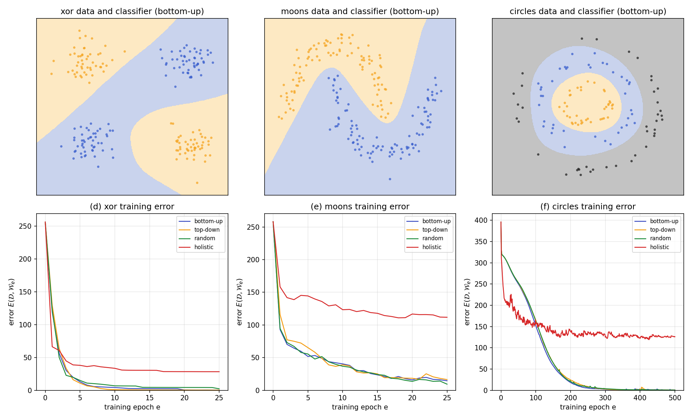
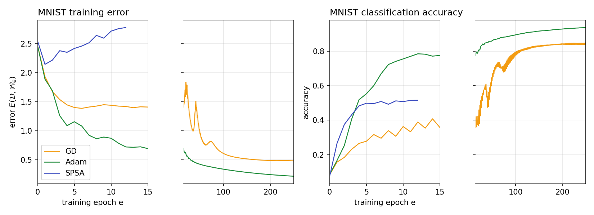

## SPSA Paper Implementation

A PyTorch reproduction (CPU or GPU) of

> B. Wulff, J. Schuecker, C. Bauckhage. **SPSA for Layer-Wise Training of Deep Networks.**
> ICANN 2018, LNCS 11141, pp. 564–573. https://doi.org/10.1007/978-3-030-01424-7_55

The paper trains feed-forward tanh networks **without backpropagation**. It uses
Spall's *simultaneous perturbation stochastic approximation* (SPSA): each
update needs only two forward passes. The authors compare two schemes:

* **holistic** SPSA, which perturbs all weights at once;
* **layer-wise** SPSA (Algorithm 2), which updates one layer at a time while
  the others stay fixed. The layers can be visited bottom-up, top-down or in a
  random order.

This repository contains a reference implementation of both algorithms,
scripts that regenerate Fig. 1 (xor / moons / circles) and Fig. 2 (MNIST,
SPSA vs. gradient descent), and unit tests.

**Implementation by:** Ananth Shyam, Rama Narasimha and Mahan Bhimireddy.

---

## 1. Repository layout

```
SPSA-Paper-Implementation/
├── spsa_nn/                    # the library
│   ├── spsa.py                 # Algorithm 1 – plain SPSA (NumPy), any f: R^m -> R
│   ├── mlp.py                  # Eqs. 5–7 network, Eq. 9 error; batched over K trials
│   ├── layerwise.py            # Algorithm 2 – layer-wise / holistic SPSA training (PyTorch, GPU)
│   ├── gd.py                   # gradient-descent baseline (backprop) for Fig. 2
│   ├── datasets.py             # xor, moons, circles generators + MNIST download/loader
│   ├── plotting.py             # Fig. 1 / Fig. 2 style plots
│   ├── device.py               # auto GPU/CPU selection, seeding
│   └── paths.py                # data/ and results/ locations (env-var overridable)
├── experiments/
│   ├── run_didactic.py         # Fig. 1  (Sect. 4.1)
│   ├── run_mnist.py            # Fig. 2  (Sect. 4.2)
│   ├── plot_results.py         # re-draw figures from results/*.json
│   └── summarize.py            # Markdown result tables from saved json
├── scripts/
│   ├── check_setup.py          # prints torch/CUDA info + 3-second smoke test
│   ├── download_mnist.py       # fetches MNIST into data/mnist/
│   ├── reproduce_all.ps1       # everything, Windows PowerShell
│   └── reproduce_all.sh        # everything, bash
├── examples/
│   ├── sphere.py               # Algorithm 1 on a sphere function
│   └── layerwise_xor.py        # minimal library usage
├── tests/test_spsa_nn.py       # pytest unit tests
├── notebooks/
│   ├── SPSA_layerwise_training.ipynb   # self-contained notebook: all code + all experiments, executed
│   └── notebook_results/       # json + png written by the notebook run
├── paper_results/              # our full-protocol results: data/, figures/, logs/, SUMMARY.md
├── data/                       # datasets land here (git-ignored)
├── results/                    # your runs write here (git-ignored); --quick -> results/quick/
├── .github/workflows/tests.yml # CI: unit tests + smoke test on Linux and Windows (CPU)
├── requirements.txt
├── setup.py
├── CITATION.cff                # "Cite this repository" metadata (points to the paper)
└── LICENSE
```

## 2. Installation

Python ≥ 3.9. Run all commands from the repository root.

### Windows (PowerShell)

```powershell
cd SPSA-Paper-Implementation
python -m venv .venv
.\.venv\Scripts\Activate.ps1
# GPU (NVIDIA): install the CUDA build of PyTorch FIRST (pick your CUDA version on pytorch.org)
pip install torch --index-url https://download.pytorch.org/whl/cu126
pip install -r requirements.txt
pip install -e .            # optional: makes `import spsa_nn` work from anywhere
```

### Linux / macOS

```bash
cd SPSA-Paper-Implementation
python3 -m venv .venv && source .venv/bin/activate
pip install torch --index-url https://download.pytorch.org/whl/cu126   # skip on CPU-only / macOS
pip install -r requirements.txt
```

### Check that the GPU is used

```bash
python scripts/check_setup.py
```

Expected output on a GPU machine:

```
torch.cuda.is_available() = True, CUDA 12.6
selected device: cuda:0 (NVIDIA GeForce ...)
smoke test: 100 xor networks, 3 epochs in ...s, mean error 259.9 -> 30.6
OK
```

Every script takes `--device auto|cuda|cuda:0|cpu|mps`. The default `auto`
picks CUDA when it's available and falls back to CPU. If it reports
`is_available() = False` on a machine that has a GPU, one of these is the cause:

* a CPU-only torch wheel is installed (re-install it with the `--index-url`
  line above);
* the NVIDIA driver is missing or too old (`nvidia-smi` must work);
* on a laptop with switchable graphics, the dGPU is disabled.

## 3. Data

| data set | source | location |
|---|---|---|
| xor, moons, circles | generated in `spsa_nn/datasets.py`, deterministic per `--data-seed` | in memory |
| MNIST | downloaded automatically on first use | `data/mnist/` |

```bash
python scripts/download_mnist.py
```

The script downloads the 4 original IDX files from the first mirror that
answers (`ossci-datasets.s3.amazonaws.com`, `storage.googleapis.com/cvdf-datasets`,
`yann.lecun.com`), parses them, and caches `data/mnist/mnist.npz`
(~11 MB).

* **Other location**: set `SPSA_DATA_DIR` (e.g. `$env:SPSA_DATA_DIR="D:\datasets"`).
  MNIST is then read from or written to `$SPSA_DATA_DIR/mnist/`. Results go
  to `results/`, or to the folder in `SPSA_RESULTS_DIR` if you set it.
* **Offline**: copy `train-images-idx3-ubyte(.gz)`,
  `train-labels-idx1-ubyte(.gz)`, `t10k-images-idx3-ubyte(.gz)` and
  `t10k-labels-idx1-ubyte(.gz)` into `data/mnist/`. An existing torchvision
  `MNIST/raw` folder inside `data/mnist/` also works.

Preprocessing follows the paper. Pixels are scaled to [0, 1] and flattened
to 784 values, labels are one-hot in {0,1}^10, and the full 60k/10k split is
used.

## 4. Running the experiments

There are six experiments: the five below and the unit tests. Every command is
run from the repository root and uses the GPU automatically if one is
available (`--device cpu` forces CPU). Each run writes JSON (full per-epoch
histories for every trial), the trained parameters (`.pt`) and PNG figures
to `results/`. `--quick` runs write to `results/quick/` instead and never
overwrite full results.

### Everything at once

```powershell
.\scripts\reproduce_all.ps1            # full protocol (~90 min on an RTX 3050, mostly circles)
.\scripts\reproduce_all.ps1 -Quick     # smoke test, a few minutes
```
```bash
bash scripts/reproduce_all.sh          # or: bash scripts/reproduce_all.sh --quick
```

### 4.1 xor (Fig. 1a, 1d)

```bash
python experiments/run_didactic.py --datasets xor
```
2×5×5×5×1 network, β = 0.5, 200 points, 100 trials × 4 variants × 25 epochs. Takes about 1–2 min.
Output: `results/didactic_xor.json`, `results/didactic_xor_params.pt`, `results/fig1_xor.png`.

### 4.2 moons (Fig. 1b, 1e)

```bash
python experiments/run_didactic.py --datasets moons
```
2×5×5×5×1 network, β = 0.5, 200 points, 100 trials × 4 variants × 25 epochs. Takes about 1–2 min.
Output: `results/didactic_moons.json`, `results/fig1_moons.png`.

### 4.3 circles (Fig. 1c, 1f)

```bash
python experiments/run_didactic.py --datasets circles                 # paper protocol, ~70 min on GPU
python experiments/run_didactic.py --datasets circles --trials 20     # ~5x faster, same conclusions
```
2×10×10×10×10×10×3 network, β = 0.25, 120 points, 100 trials × 4 variants × 500 epochs.
Output: `results/didactic_circles.json`, `results/fig1_circles.png`. Once
all three data sets have been run, the combined `results/fig1.png` is
written as well.

Useful options for every didactic run:
* `--variants bottom-up holistic`: run only some of the variants;
* `--a 0.01 --c 0.1 --alpha 1 --gamma 0.1667 --t-max 50`: change the SPSA gains;
* `--epochs`, `--n`, `--init standard|glorot|normal`, `--seed`, `--data-seed`, `--double`.

### 4.4 MNIST: layer-wise SPSA vs. gradient descent (Fig. 2)

The network is **784×784×196×10 = 771,270 parameters**, the count the paper
states (see section 6 for why this, and not the prose "784×196×10", is the
default).

```bash
python scripts/download_mnist.py          # once (also happens automatically)
python experiments/run_mnist.py           # 3 SPSA runs x 12 epochs + GD 250 epochs, ~6 min on an RTX 3050
```
Output: `results/mnist.json`, `results/fig2.png`.
Options include `--hidden`, `--a --c --alpha --gamma --t-max --epochs --runs --objective --batch-size --init`,
`--gd-lr --gd-epochs --gd-batch-size`, and `--skip-gd` / `--skip-spsa`.

### 4.5 MNIST ablations from the text of Sect. 4.2

```bash
python experiments/run_mnist.py --order holistic --skip-gd --name mnist_holistic          # "holistic failed", ~6 min
python experiments/run_mnist.py --no-split-bias  --skip-gd --name mnist_no_split_bias     # "no learning without split", ~2.5 min
```
Output: `results/mnist_holistic.json`, `results/fig2_mnist_holistic.png`, and
the same pair for `mnist_no_split_bias`.

### 4.6 MNIST with the literal text topology, 784×196×10 (155,830 parameters)

```bash
python experiments/run_mnist.py --hidden 196 --name mnist_155k                                      # ~1.5 min
python experiments/run_mnist.py --hidden 196 --order holistic --skip-gd --name mnist_155k_holistic
python experiments/run_mnist.py --hidden 196 --no-split-bias  --skip-gd --name mnist_155k_no_split_bias
```
`--hidden` takes the hidden layer sizes and works with every other option.

### Notebook version (everything in one place)

[`notebooks/SPSA_layerwise_training.ipynb`](notebooks/SPSA_layerwise_training.ipynb) is a
**self-contained** walkthrough. It does not import `spsa_nn`: Algorithm 1, the network, Algorithm 2,
the datasets, MNIST loading and the GD baseline are all written out in cells, in the order of the
paper. Running it top to bottom reproduces every experiment above (Fig. 1, Fig. 2 and the two MNIST
ablations, on both the 771k and the 155k MNIST network). It is saved **with all outputs** from a
full run on an RTX 3050.

```bash
pip install jupyter            # if needed
jupyter notebook notebooks/SPSA_layerwise_training.ipynb     # or open it in VS Code
```
* `QUICK = True` in the configuration cell: smoke test, ≈ 8 min on GPU (outputs go to `notebooks/notebook_results_quick/`).
* `QUICK = False` (default): the paper protocol, ≈ 65 min on an RTX 3050 (≈ 45 for circles, ≈ 15 for MNIST);
  a power-throttled laptop GPU can take about twice as long.
  `N_TRIALS_CIRCLES = 20` cuts that to ≈ 15 min.
* Data: it uses the repository's `data/` folder (or `./data` if the notebook is moved out of the
  repo) and downloads MNIST if needed.

### Re-plotting and summarising (no training)

```bash
python experiments/plot_results.py                          # redraw all figures from results/*.json
python experiments/summarize.py                             # Markdown tables of results/
python experiments/summarize.py --dir paper_results/data    # tables of the shipped reference results
```

### Tests

```bash
python -m pytest -q          # 19 tests, ~10 s (the CUDA test is skipped without a GPU)
```

## 5. Paper → code

| paper | code |
|---|---|
| Algorithm 1 (SPSA), Eq. 4 | `spsa_nn/spsa.py::iterate/minimize`; same rule in `layerwise.spsa_call` |
| δ_i ~ U{−1,+1} | `spsa.rademacher`, `layerwise._rademacher` |
| a_t = a/t^α, c_t = c/t^γ, restarted at every SPSA call | `SPSAConfig.gains` |
| Eqs. 5–7, a^l = tanh(β W^l a^{l−1}) with bias | `mlp.forward` |
| Eq. 9, E(D,W) = Σ‖y(x_i)−y_i‖² | `mlp.error(..., "sum")` |
| Algorithm 2 (layer-wise epochs) | `layerwise.train` |
| Eqs. 11–13 (top-down / bottom-up / random) | `layerwise.epoch_schedule` |
| holistic baseline | `order="holistic"` |
| Sect. 4.2 "first weights, then biases" | `TrainConfig(split_bias=True)` |
| GD baseline (`tf.train.GradientDescentOptimizer`, lr 0.01) | `spsa_nn/gd.py` |

## 6. Settings and the choices the paper leaves open

**Taken from the paper:**

* architectures: 2×5×5×5×1 (81 parameters), 2×10×10×10×10×10×3 (503) and,
  for MNIST, 771,270 parameters (see "MNIST network" below);
* β: 0.5, 0.25 and 1;
* labels in {−1,+1} and {0,1}^10;
* the objective (Eq. 9);
* 100 trials per variant;
* epochs: 25, 25 and 500 in Fig. 1, 12 SPSA epochs in Fig. 2;
* MNIST SPSA settings: a = c = 0.1, t_max = 50, bottom-up, weights then
  biases;
* GD learning rate 0.01.

**Not specified in the paper, so I chose them here.** Every value can be
changed from the command line:

| setting | value | reason |
|---|---|---|
| init (didactic) | W, b ~ N(0,1) (`tf.random_normal`) | gives the initial errors in Fig. 1 (≈260 for xor/moons vs ≈270 in the paper) |
| init (MNIST) | Glorot-uniform weights, zero bias (TF `dense` default) | initial E ≈ 2.7 per sample, as in Fig. 2 |
| #points | xor 200, moons 200, circles 120 | the initial errors in Fig. 1 imply about these sizes |
| didactic gains | xor a=0.01, moons a=0.02, circles a=0.005; c=0.1, α=1, γ=1/6, t_max=50 | inside the paper's stated ranges (α ≥ 1, γ ∈ [1/6, 1/2]); a was tuned |
| MNIST α, γ | 0.602, 0.101 | Spall's recommended values; the authors' TF optimizer cites that reference |
| MNIST SPSA objective | `tf.reduce_mean((y−ŷ)²)` = Eq. 9 / (n·10) | TF-style loss. With Eq. 9 / n, a = 0.1 diverges |
| logged MNIST error | Eq. 9 / n | the scale of the y-axis in Fig. 2 |
| GD baseline | full-batch | matches the slow GD curve in Fig. 2 (lr 0.01) |
| holistic budget | L SPSA calls of t_max iterations per epoch | same number of forward passes as layer-wise |
| random order | independent permutation per trial and per epoch | Eq. 13 |

**MNIST network: the paper is inconsistent.** Its prose gives the topology
as 784×196×10, which has only 784·196 + 196 + 196·10 + 10 = **155,830**
parameters. But it states **771,270** parameters (p. 570), and twice more
says SPSA trains networks with *"close to a million"* / *"almost a million"*
parameters (p. 571 and the conclusion). The count is stated three times, the
topology once, so the count looks intentional and the topology description
incomplete. One extra 784-unit hidden layer, **784×784×196×10**, gives exactly
771,270, so that is the default here. The authors' public TensorFlow code
doesn't settle this (its only example is a 784×10 softmax model), so the
literal 784×196×10 network is also run (section 4.6) and reported in
section 7. `test_parameter_counts_match_paper` checks all four counts (81,
503, 155,830 and 771,270).

## 7. Our results

Every number below comes from the default commands of section 4 (seed 0,
float32). xor and circles ran on an RTX 3050 6 GB Laptop GPU, moons on CPU;
the device does not change the conclusions. The complete outputs are stored
in [`paper_results/`](paper_results/):

```
paper_results/
├── SUMMARY.md     # the tables below, generated by experiments/summarize.py
├── data/          # didactic_*.json, mnist*.json (per-epoch history of every trial) + trained params *.pt
├── figures/       # fig1.png, fig1_<dataset>.png, fig2.png (771k), fig2_mnist_{holistic,no_split_bias}.png, fig2_mnist_155k*.png
└── logs/          # console logs of the 771k MNIST runs and the 155k ablations
```

To print these tables from the saved data, or to compare a run of yours
against them: `python experiments/summarize.py --dir paper_results/data`.

### Reproduction status

| paper result | reproduced? | ours |
|---|---|---|
| Fig. 1: layer-wise beats holistic on xor, moons, circles | ✅ yes | holistic final error 28 / 112 / 126 vs ≤ 16 for layer-wise |
| Fig. 1: layer order (bottom-up / top-down / random) doesn't matter | ✅ yes | curves practically on top of each other |
| Fig. 1c/f: holistic doesn't converge on circles | ✅ yes | only 40 % of trials ≥ 95 % accuracy, vs 100 % for layer-wise |
| Fig. 2: SPSA learns faster than GD in the first epochs | ✅ yes | epoch 12: 0.515 (SPSA) vs 0.389 (GD) test accuracy |
| Fig. 2: GD ends higher after long training | ✅ yes | GD 0.848 at epoch 250 |
| Fig. 2: SPSA ≈ 0.72 test accuracy at epoch 12, training error falling | ⚠️ partly | 0.515 (0.48–0.56 over 3 runs); the training error rises slightly (2.55 → 2.78) |
| Sect. 4.2: holistic SPSA fails on MNIST | ⚠️ partly | the objective diverges (E 2.55 → 5.60); accuracy still climbs to 0.47 |
| Sect. 4.2: no learning without the weights/biases split | ❌ no | without the split: 0.527, same as with it (0.515) |
| Sect. 4.2: 771,270 parameters | ✅ count | matched exactly by 784×784×196×10. The literal 784×196×10 (155,830) gives the same conclusions, with SPSA slightly better (0.548) |

### Fig. 1: didactic problems (100 trials each)



| data set | variant | E start | E final (mean) | E final (median) | train acc | trials ≥ 95 % acc | time |
|---|---|---|---|---|---|---|---|
| xor | bottom-up | 256.2 | 0.24 | 0.17 | 1.000 | 100 % | 10 s |
| xor | top-down | 256.2 | 0.22 | 0.18 | 1.000 | 100 % | 10 s |
| xor | random | 256.2 | 2.24 | 0.18 | 0.998 | 99 % | 27 s |
| xor | **holistic** | 256.2 | **28.27** | 0.04 | 0.965 | **86 %** | 26 s |
| moons | bottom-up | 258.1 | 14.57 | 0.16 | 0.981 | 90 % | 11 s |
| moons | top-down | 258.1 | 16.40 | 0.13 | 0.979 | 88 % | 11 s |
| moons | random | 258.1 | 9.38 | 0.14 | 0.987 | 87 % | 24 s |
| moons | **holistic** | 258.1 | **111.77** | 74.87 | 0.858 | **31 %** | 38 s |
| circles | bottom-up | 396.0 | 0.43 | 0.39 | 1.000 | 100 % | 8 min |
| circles | top-down | 396.0 | 0.45 | 0.42 | 1.000 | 100 % | 9 min |
| circles | random | 396.0 | 0.49 | 0.40 | 1.000 | 100 % | 31 min |
| circles | **holistic** | 396.0 | **125.98** | 70.97 | 0.817 | **40 %** | 22 min |

The starting errors (≈ 256, 258, 396) match the paper's plots (≈ 270, 265, 400).
On circles, holistic training drops quickly and then levels off around 125,
whereas in the paper it rises again; layer-wise training goes to ≈ 0.

### Fig. 2 and Sect. 4.2: MNIST (3 SPSA runs)

Main experiment, 771,270-parameter network (784×784×196×10):



| run | network (params) | method | order | weights/biases split | epochs | E start → final | test acc at epoch 12 (per run) | final test acc |
|---|---|---|---|---|---|---|---|---|
| `mnist` | 784×784×196×10 (771,270) | SPSA | bottom-up | yes | 12 | 2.55 → 2.78 | 0.481, 0.558, 0.505 | 0.515 |
| `mnist` | 784×784×196×10 (771,270) | GD (full batch, lr 0.01) | – | – | 250 | 2.46 → 0.48 | 0.389 | 0.848 |
| `mnist_holistic` | 784×784×196×10 (771,270) | SPSA | holistic | yes | 12 | 2.55 → **5.60** | 0.465, 0.408, 0.527 | 0.467 |
| `mnist_no_split_bias` | 784×784×196×10 (771,270) | SPSA | bottom-up | no | 12 | 2.55 → 2.71 | 0.524, 0.484, 0.572 | 0.527 |

For comparison, the literal text topology (784×196×10):

| run | network (params) | method | order | weights/biases split | epochs | E start → final | test acc at epoch 12 (per run) | final test acc |
|---|---|---|---|---|---|---|---|---|
| `mnist_155k` | 784×196×10 (155,830) | SPSA | bottom-up | yes | 12 | 2.54 → 2.01 | 0.519, 0.566, 0.558 | 0.548 |
| `mnist_155k` | 784×196×10 (155,830) | GD (full batch, lr 0.01) | – | – | 250 | 2.34 → 0.55 | 0.352 | 0.805 |
| `mnist_155k_holistic` | 784×196×10 (155,830) | SPSA | holistic | yes | 12 | 2.54 → **4.37** | 0.482, 0.493, 0.481 | 0.485 |
| `mnist_155k_no_split_bias` | 784×196×10 (155,830) | SPSA | bottom-up | no | 12 | 2.54 → 1.98 | 0.559, 0.587, 0.530 | 0.558 |

Both networks support the paper's qualitative claims. SPSA, with forward
passes only, is well ahead of GD after 12 epochs, GD overtakes it later, and
holistic SPSA is the worst. Neither network reaches the paper's ≈ 0.72.

On the 771k network the SPSA training error creeps up (2.55 → 2.78) while
the accuracy improves. In the paper's Fig. 2a the error falls. With the
paper's gains, each step on the 615k-parameter first layer is noisy; this is
the curse of dimensionality the paper describes. The smaller network's error
falls (2.54 → 2.01) and its accuracy is slightly higher. The gap to the paper
therefore isn't explained by the architecture; it points to details the
paper doesn't report (init, loss scale, gain schedule), all of which can be
changed through `run_mnist.py` flags. GD benefits from the bigger network
(0.848 vs 0.805).

### Runtimes (RTX 3050 Laptop GPU)

| experiment | time |
|---|---|
| xor or moons, all 4 variants | ≈ 1.5 min |
| circles, all 4 variants (100 trials × 500 epochs) | ≈ 70 min |
| MNIST 771k: SPSA 3 runs × 12 epochs + GD 250 epochs | ≈ 5 min + 40 s |
| MNIST 771k ablations: holistic / no split | ≈ 6 min / 2.5 min |
| MNIST 155k: SPSA + GD, and each ablation | ≈ 1.2 min, 0.5–1 min |

Random order and holistic are slower because they can't cache the outputs
of the fixed lower layers. The tiny didactic networks are limited by
kernel-launch overhead, so the GPU helps far more on MNIST: on CPU, 155k MNIST
SPSA takes ~25 s per epoch per run, and the 771k network about 5× longer.

## 8. Using the library

```python
from spsa_nn import datasets, layerwise, mlp, get_device

device = get_device("auto")
data = datasets.make_moons(n=200)
cfg = layerwise.TrainConfig(
    sizes=[2, 5, 5, 5, 1], order="random", epochs=25, beta=0.5, n_trials=100, init="standard",
    spsa=layerwise.SPSAConfig(a=0.02, c=0.1, alpha=1.0, gamma=1/6, t_max=50))
params, history = layerwise.train(data.x, data.y, cfg, device)   # history["error"]: (epochs+1) x trials
```

Plain SPSA on any function:

```python
import numpy as np
from spsa_nn import spsa
x = spsa.minimize(lambda x: np.sum(x**2), np.ones(10), a=0.2, alpha=0.602, c=0.1, gamma=0.101, t_max=2000)
```

## 9. Publishing this repository on GitHub

`.gitignore` already keeps out the things that don't belong in the repo:
downloaded data (`data/`), your own run outputs (`results/`, `results/quick/`,
`notebooks/notebook_results_quick/`), caches, local copies of the paper
(`*.pdf`, which is copyrighted by Springer) and the local `working/` folder.
The reference results in `paper_results/` and `notebooks/notebook_results/`
*are* committed, so readers can see the numbers without running anything.
The whole repository is about 16 MB.

```bash
git init -b main          # already done if a .git folder exists
git add .
git status                # check: no data/, results/, working/ or .pdf files listed
git commit -m "SPSA layer-wise training: full reproduction of Wulff et al. (ICANN 2018)"
# create an empty repository named SPSA-Paper-Implementation on github.com (no README/licence), then:
git remote add origin https://github.com/<your-user>/SPSA-Paper-Implementation.git
git push -u origin main
```

On every push, GitHub Actions (`.github/workflows/tests.yml`) runs the unit
tests and a short Fig. 1 run on Linux and Windows. To show the status on the
repo page, add this badge at the top of the README:
``.

## 10. Authors

This reproduction was implemented by:

* **Ananth Shyam**
* **Rama Narasimha**
* **Mahan Bhimireddy**

The method and the experiments are from the original paper by Wulff,
Schuecker and Bauckhage (below).

## 11. Citation

```bibtex
@inproceedings{wulff2018spsa,
  title     = {SPSA for Layer-Wise Training of Deep Networks},
  author    = {Wulff, Benjamin and Schuecker, Jannis and Bauckhage, Christian},
  booktitle = {Artificial Neural Networks and Machine Learning -- ICANN 2018},
  series    = {LNCS}, volume = {11141}, pages = {564--573},
  publisher = {Springer}, year = {2018},
  doi       = {10.1007/978-3-030-01424-7_55}
}
```

The authors' original TensorFlow 1.x optimizer is at
https://github.com/fraunhofer-iais/tensorflow_spsa. The package layout here
follows https://github.com/SimpleArt/spsa.
