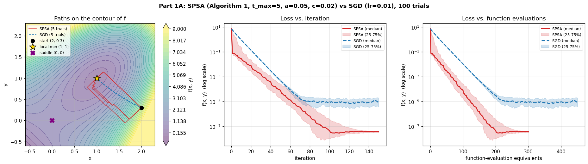
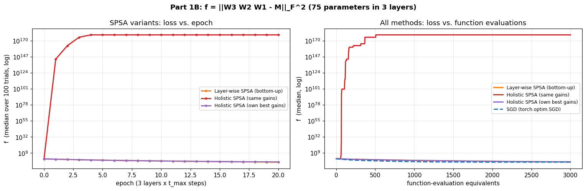
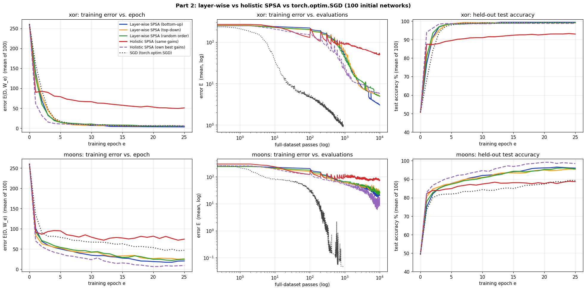
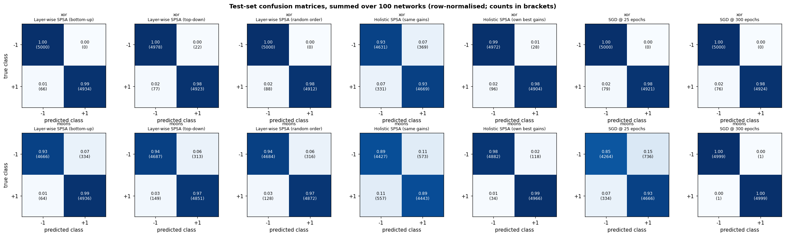
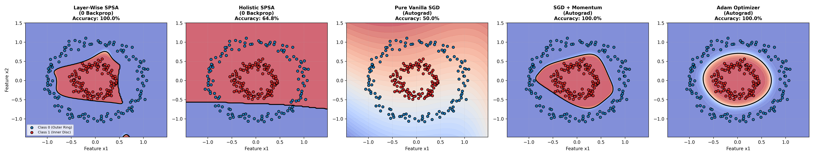
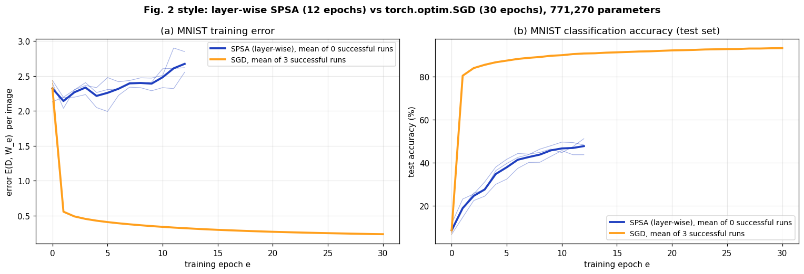
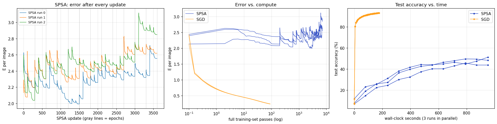
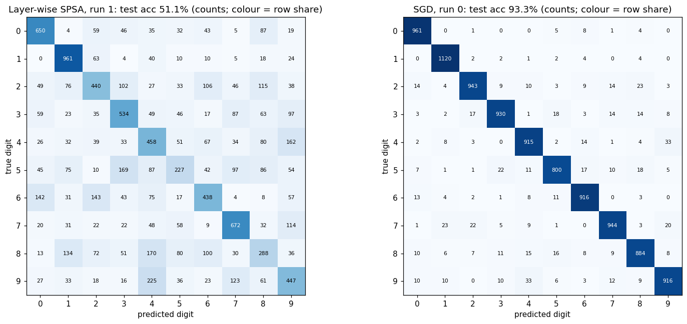

# SPSA Demonstration: Layer-Wise SPSA vs. `torch.optim.SGD`

**Implementation by**: Ananth Shyam, Rama Narasimha and Mahan Bhimireddy
**Paper**: B. Wulff, J. Schuecker, C. Bauckhage. *SPSA for Layer-Wise Training of Deep Networks.* ICANN 2018, LNCS 11141, pp. 564–573. [doi:10.1007/978-3-030-01424-7_55](https://doi.org/10.1007/978-3-030-01424-7_55)

Everything is in one notebook, [`spsa_demonstration.ipynb`](spsa_demonstration.ipynb). It runs top to bottom in about 7 minutes on a CUDA GPU (RTX 3050) and also runs on a CPU. All numbers below come from that run, with 100 trials per method.

```text
demo/implementation demonstration/
├── spsa_demonstration.ipynb        # Parts 1–2: math functions, XOR and moons (Fig. 1)
├── MNIST_SPSA_vs_SGD.ipynb         # MNIST, 771,270 parameters (Sect. 4.2, Fig. 2)
├── README.md                       # this file
└── figures/                        # figures exported from the executed notebooks
    ├── mnist_*.png                 # 6 MNIST figures
    ├── part1a_cubic_spsa_vs_sgd.png
    ├── part1b_layerwise_matrix_factorisation.png
    ├── part2_datasets.png
    ├── part2_loss_curves.png
    ├── part2_confusion_matrices.png
    └── part2_decision_boundaries.png
```

## Requirements covered

| Requirement | Where |
|---|---|
| SPSA on a sample mathematical function, converging to the minimum | Part 1A (2-D cubic, Algorithm 1) and Part 1B (3-factor matrix product, Algorithm 2) |
| SPSA training a small neural network without backpropagation | Part 2 (the paper's 2×5×5×5×1 network on XOR and moons) |
| Loss curve and comparison with SGD or Adam | All parts compare against `torch.optim.SGD`, by iteration/epoch and by function evaluations. Part 2 adds test precision, recall, F1 and confusion matrices. |

## What follows the paper

- **Algorithm 1 (SPSA).** Random ±1 perturbations, 2 function evaluations per step, gains aₜ = a/t and cₜ = c/t^(1/6).
- **Algorithm 2 (layer-wise SPSA).** Update one layer at a time, keeping the others fixed, in bottom-up, top-down or random order. The gains restart on each layer visit (paper Sect. 5).
- **Network.** 2×5×5×5×1 with biases (81 parameters), tanh(0.5·z) on all layers including the output, labels ±1, loss Eq. 9 (sum of squared residuals).
- **Protocol.** 100 random initialisations and 25 epochs, as in Fig. 1d/1e. Holistic SPSA is the baseline and gets the same number of function evaluations as layer-wise SPSA.
- **Not given by the paper.** The paper does not report a, c or tₘₐₓ for Fig. 1. We use tₘₐₓ = 50 (its MNIST value) and choose a, c and the SGD learning rate by sweeps on separate tuning seeds.
- **Not reproduced.** The 3-class circles task (Fig. 1c). MNIST (Fig. 2) has its own notebook, described below. The paper's XOR/moons data is not published, so it is regenerated (200 train / 100 test points).
- **Coordinate-wise finite differences are not in the paper** and are not used.

## Part 1A: SPSA vs. SGD on f(x, y) = x³ + y³ − 3xy + 1

Start (2, 0.3), local minimum (1, 1), 150 iterations, 100 trials. SGD uses the exact gradient plus N(0, 0.05²) noise.

| Method | Setting | Function evals | Converged to (1, 1) | Median final f |
|---|---|---|---|---|
| SPSA (Algorithm 1) | tₘₐₓ = 5, a = 0.05, c = 0.02 | 300 | 100% | 3.7·10⁻⁸ |
| SGD (`torch.optim.SGD`) | lr = 0.01 | 450 (equivalents) | 100% | 1.0·10⁻⁵ |

SGD levels off at a floor set by its gradient noise. Without the gain restarts (tₘₐₓ = 50), at most 82% of SPSA trials converge.



## Part 1B: layer-wise SPSA on f = ‖W₃W₂W₁ − M‖²_F (75 parameters, 3 layers)

All methods get 3,000 function evaluations (equivalents for SGD), 100 trials.

| Method | Setting | Diverged | Median final f |
|---|---|---|---|
| Layer-wise SPSA (bottom-up) | a = 0.03, c = 0.1 | 0% | 9.1·10⁻⁵ |
| Holistic SPSA, same gains | a = 0.03, c = 0.1 | **100%** | – |
| Holistic SPSA, its own best gains | a = 0.01, c = 0.02 | 0% | 1.9·10⁻⁴ |
| SGD (`torch.optim.SGD`) | lr = 0.005 | 0% | 7.7·10⁻⁵ |



## Part 2: the paper's network on XOR and moons (100 initial networks)

- **Training error E** (Eq. 9) is measured on 200 training points. "Success" means at least 95% training accuracy.
- **Test metrics** are on 100 held-out points (mean over 100 networks; positive class +1).
- **Settings.** Shared SPSA gains a = 0.01, c = 0.1 on both tasks. Holistic's own best a is 0.005 (c = 0.1 for XOR, 0.2 for moons). SGD uses batch 25, with lr = 0.05 (XOR) and lr = 0.1 (moons).

### XOR

| Method | Dataset passes | Mean E | Success | Test acc | Precision | Recall | F1 |
|---|---|---|---|---|---|---|---|
| Layer-wise SPSA, bottom-up | 10,000 | **3.03** | 100% | 99.3 | 100.0 | 98.7 | 99.3 |
| Layer-wise SPSA, top-down | 10,000 | 5.00 | 99% | 99.0 | 99.7 | 98.5 | 99.0 |
| Layer-wise SPSA, random | 10,000 | 4.94 | 99% | 99.1 | 100.0 | 98.2 | 99.0 |
| Holistic SPSA, same gains | 10,000 | 50.75 | 76% | 93.0 | 95.3 | 93.4 | 92.8 |
| Holistic SPSA, own best gains | 10,000 | 5.80 | 98% | 98.8 | 99.6 | 98.1 | 98.7 |
| SGD, 25 epochs | 75 | 5.28 | 100% | 99.2 | 100.0 | 98.4 | 99.2 |
| SGD, 300 epochs | 900 | 0.91 | 100% | 99.2 | 100.0 | 98.5 | 99.2 |

### Moons

| Method | Dataset passes | Mean E | Success | Test acc | Precision | Recall | F1 |
|---|---|---|---|---|---|---|---|
| Layer-wise SPSA, bottom-up | 10,000 | **20.41** | 82% | 96.0 | 94.8 | 98.7 | 96.5 |
| Layer-wise SPSA, top-down | 10,000 | 25.70 | 75% | 95.4 | 93.9 | 97.0 | 95.2 |
| Layer-wise SPSA, random | 10,000 | 24.55 | 81% | 95.6 | 94.0 | 97.4 | 95.5 |
| Holistic SPSA, same gains | 10,000 | 74.27 | 60% | 88.7 | 84.9 | 88.9 | 86.1 |
| Holistic SPSA, own best gains | 10,000 | 9.14 | 93% | 98.5 | 98.1 | 99.3 | 98.6 |
| SGD, 25 epochs | 75 | 46.71 | 42% | 89.3 | 88.0 | 93.3 | 89.8 |
| SGD, 300 epochs | 900 | 0.05 | 100% | 100.0 | 100.0 | 100.0 | 100.0 |





## Takeaways

1. **Layer-wise beats holistic SPSA at the same gains, as the paper reports.** Mean E is 3.0 vs. 50.8 on XOR and 20.4 vs. 74.3 on moons. Holistic SPSA succeeds in only part of the trials (76% and 60%). The paper: *"layer-wise SPSA according to Algorithm 2 learns better than a holistic variant ... learning converges only for a fraction of trials."* Its Fig. 1d/1e show roughly 5 vs. 90 and 10 vs. 85 (read off the plots).
2. **The layer order hardly matters, as the paper reports.** Median E for bottom-up, top-down and random order is 3.02 / 2.85 / 2.88 on XOR and 6.48 / 5.89 / 6.15 on moons.
3. **On this small network the real gain is step-size tolerance.** Holistic SPSA with its own smaller step size does as well (XOR 5.80, moons 9.14). On the matrix-product function, holistic SPSA diverges in every trial at the layer-wise step size.
4. **SGD is far more efficient per unit of compute.** Layer-wise SPSA is ahead per epoch, but one SPSA epoch costs 400 dataset passes against SGD's 3. With 900 passes, SGD reaches a 100% test accuracy on moons. The paper makes the same caveat: *"we neither aim for a quantitative comparison between the two approaches nor for achieving state of the art results."* SPSA's value is training with forward passes only.

## MNIST: layer-wise SPSA vs. `torch.optim.SGD` (paper Sect. 4.2, Fig. 2)

Notebook: [`MNIST_SPSA_vs_SGD.ipynb`](MNIST_SPSA_vs_SGD.ipynb). It runs in about 24 minutes on an RTX 3050; the 3 runs of each method train in parallel.

**Set-up, as in the paper:**
- Network: 784×784×196×10 = 771,270 parameters, tanh with β = 1, one-hot targets.
- SPSA: bottom-up, with **weights then biases** of each layer as separate calls; a = 0.1, c = 0.1, tₘₐₓ = 50, α = 1, γ = 1/6.
- 3 runs per method.
- Baseline: `torch.optim.SGD` with the paper's learning rate of 0.01 (batch 64).
- Every SPSA evaluation uses all 60,000 training images.

| Method | Epochs | Full passes | Test accuracy per run | Final E per image |
|---|---|---|---|---|
| Holistic SPSA | 2 | 1,200 | 26.8 / 28.2 / 32.8% | 4.93 / 4.61 / 5.32 (start ≈ 2.3) |
| Layer-wise SPSA | 12 | 7,200 | 48.2 / 51.2 / 43.7% | 2.56 / 2.62 / 2.85 (start ≈ 2.3) |
| SGD (`torch.optim.SGD`) | 30 | 90 | 93.3 / 93.2 / 93.1% | 0.23 |

- **As in the paper:**
  - Holistic SPSA fails: its error doubles.
  - Layer-wise SPSA learns from forward passes only: test accuracy goes from 8.6% to 47.7% (mean over the 3 runs).
- **Not as in the paper:**
  - The paper shows ≈ 72% accuracy and an error of ≈ 1.3 after 12 epochs.
  - Here the error ends *above* its start, so no run counts as "successful" under our rule (final E below starting E). The paper-style average is therefore the mean of all 3 runs.
  - The per-update plot shows why: each SPSA call restarts at the largest step a₁ = 0.1, which moves every weight of the layer at once. E jumps up, then only partly recovers.
  - The paper does not report its initialisation, input scaling or gain exponents, and these change the effective step size.
- **SGD:** with the same learning rate, it reaches 93.2% using 1/80 of SPSA's compute. The paper's own GD baseline was much slower (≈ 75% after 250 epochs).





## How to run

```bash
pip install -r ../../requirements.txt
cd "demo/implementation demonstration"
jupyter notebook spsa_demonstration.ipynb      # Run All; about 7 min on a GPU
jupyter notebook MNIST_SPSA_vs_SGD.ipynb       # Run All; about 24 min on a GPU
```

The MNIST notebook reads `data/mnist/mnist.npz` at the repository root, or downloads MNIST with `torchvision` if the file is missing.
